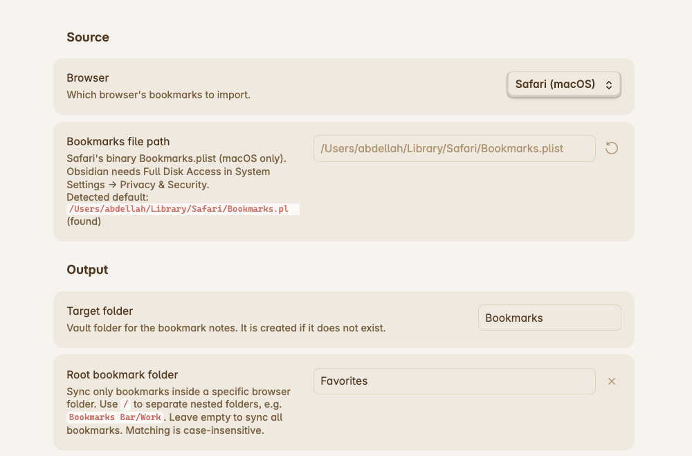

# Bookmarks Sync for Obsidian

Import Safari, Chrome or Firefox bookmarks as individual Markdown notes into your Obsidian vault, using your own customizable template.



## Features

- **Multi-browser support**: Import bookmarks directly from Google Chrome, Chromium (Brave, Edge, etc.), Safari (macOS), or Mozilla Firefox.
- **Customizable templates**: A template is a markdown file in the plugin's `templates` folder, bundled into the build with its file name as the template name. Editing a template in settings switches the selection to **Custom** and leaves the built-in file untouched. Templates use placeholders like `{{title}}`, `{{url}}`, `{{date}}`, `{{folder_path}}`, `{{domain}}`, and more.
- **Frontmatter ready**: Use filters like `{{title|yaml}}` to safely format text for YAML frontmatter.
- **Hierarchy preservation**: Mirror your browser folder tree into vault subfolders, or save all bookmarks into a flat folder.
- **Selective folder sync**: Filter by a specific root browser folder (e.g. `Bookmarks Bar/Work`) to sync only what you want.
- **Safe duplicate handling**: URL-based indexing ensures each URL produces a single note, even if filed in multiple folders.
- **Flexible automation**: Sync manually on demand, automatically on startup, or at periodic intervals.
- **Conflict-free updates**: Uses atomic vault updates so notes are modified safely without race conditions.

## Installation

### Beta testing with BRAT (Recommended)

You can easily install and test beta releases of this plugin using [Obsidian42 - BRAT](https://github.com/TfTHacker/obsidian42-brat):

1. Install and enable the **BRAT** plugin from Obsidian's Community Plugins.
2. Open Obsidian **Settings** → **BRAT**.
3. Under **Beta Plugin List**, click **Add Beta plugin**.
4. Enter the GitHub repository: `chadidi/obsidian-bookmarks-sync` (or `https://github.com/chadidi/obsidian-bookmarks-sync`).
5. Click **Add Plugin**. BRAT will download the latest release assets (`manifest.json`, `main.js`, and `styles.css`).
6. Go to **Settings** → **Community plugins** and enable **Bookmarks Sync**.

### Manual installation

1. Download the latest release (`main.js`, `manifest.json`, `styles.css`) from the [Releases](https://github.com/chadidi/obsidian-bookmarks-sync/releases) page.
2. Create a folder named `bookmarks-sync` in your vault's plugin directory: `<vault>/.obsidian/plugins/bookmarks-sync/`.
3. Copy `main.js`, `manifest.json`, and `styles.css` into that folder.
4. Reload Obsidian and enable the plugin under **Settings** → **Community plugins**.

### Build from source

```bash
git clone https://github.com/chadidi/obsidian-bookmarks-sync.git
cd obsidian-bookmarks-sync
npm install
npm run build
```

Copy `main.js`, `manifest.json`, and `styles.css` into `<vault>/.obsidian/plugins/bookmarks-sync/`.

## First run

1. Go to **Settings** → **Bookmarks Sync**.
2. Select your browser under **Source**. The plugin will automatically detect your browser's default bookmarks file path on macOS, Windows, or Linux.
3. Choose your target vault folder and template.
4. Click **Sync bookmarks** (or click the bookmark ribbon icon, or run the command `Sync bookmarks now`).
5. Automatic syncs (on startup or periodic) are kept disabled until one manual sync has completed successfully to prevent accidental imports.

## Supported browsers

| Browser | Default file location | Notes |
|---|---|---|
| **Google Chrome** | `…/Google/Chrome/Default/Bookmarks`, falling back to `…/AccountBookmarks` (macOS / Windows / Linux) | JSON file. When you are signed in, Chrome may store your bookmarks in `AccountBookmarks` instead; the plugin detects both. Custom profiles, or other Chromium-based browsers (e.g. Brave, Edge, Arc), can be used by providing their custom path in settings. |
| **Chromium** | `…/Chromium/Default/Bookmarks`, falling back to `…/AccountBookmarks` (macOS / Windows / Linux) | Same JSON layout as Chrome. Detect the default Chromium profile automatically, or set a custom profile path in settings. |
| **Safari** | `~/Library/Safari/Bookmarks.plist` (macOS) | Binary plist, parsed directly in-process. Because macOS protects `~/Library/Safari/`, either use **Choose Bookmarks.plist** in settings to grant read access to just that file for the session (no Full Disk Access needed), or grant Obsidian **Full Disk Access** in macOS **System Settings** → **Privacy & Security**. Reading List items are excluded. Safari stores no creation dates, so `{{date}}` uses the sync date. |
| **Firefox** | Auto-detected `places.sqlite` or `bookmarkbackups/*.jsonlz4` | Reads live bookmarks from `places.sqlite` using the system `sqlite3` CLI tool on a temporary database snapshot. Alternatively, point to a `bookmarkbackups/*.jsonlz4` file or directory for native decompression without `sqlite3`. |

## Template placeholders

| Placeholder | Description |
|---|---|
| `{{title}}` | Bookmark title (falls back to host/path if title is empty). |
| `{{url}}` | Full URL of the bookmark. |
| `{{date}}` | Date the bookmark was added (supports moment.js format, e.g. `{{date:YYYY-MM-DD}}`). |
| `{{synced}}` | Date the current sync occurred (e.g. `{{synced:YYYY-MM-DD HH:mm}}`). |
| `{{folder_path}}` | Full browser folder path separated by `/` (e.g. `Bookmarks Bar/Dev/Obsidian`). |
| `{{folder}}` | Immediate parent folder name (e.g. `Obsidian`). |
| `{{domain}}` | Clean domain name without `www.` (e.g. `obsidian.md`). |
| `{{browser}}` | Browser name (e.g. `Google Chrome`, `Chromium`, `Safari`, `Firefox`). |

### Filters

You can apply pipe filters to any placeholder:

- `|yaml`: Safely quotes and escapes values for YAML frontmatter (e.g. `title: {{title|yaml}}`).
- `|lower`: Converts value to lowercase.
- `|upper`: Converts value to uppercase.

## Sync behavior

- **Only sync new bookmarks (default)**: Existing notes corresponding to a bookmark are never modified.
- **Apply templates to existing bookmarks**: Existing bookmark notes will be updated if the rendered template output has changed.
- **Renaming and moving notes**: The plugin tracks notes by their URL mapping in `data.json`. Renaming or moving notes inside Obsidian will preserve the association.
- **Deleting notes**: If you delete a bookmark's note in Obsidian, it will be treated as new on the next sync and recreated.
- **Removing deleted bookmarks**: If you delete a bookmark in your browser, its note is permanently deleted from the vault on the next sync. Only notes the plugin created (tracked in `data.json`) are removed; notes for bookmarks that still exist in the browser but fall outside the configured **Browser bookmarks folder** are left untouched.

## Disclosures & privacy

- **Desktop only**: This plugin requires Obsidian's desktop application (macOS, Windows, or Linux) because it uses local filesystem access to read browser databases.
- **Filesystem access outside vault**: This plugin reads local browser bookmarks files stored on your computer (such as `Bookmarks.plist` for Safari, `Bookmarks` for Chrome, or `places.sqlite` for Firefox). These files are read strictly to import your bookmarks. When you pick a Safari `Bookmarks.plist` through the native file dialog, its contents are held in memory for the current session only and are never written to disk or persisted in settings.
- **100% offline & private**: No network requests are made. No analytics or telemetry are collected. All bookmark processing and note generation happens completely locally on your device.

## License

[MIT](LICENSE) © [Abdellah Chadidi](https://github.com/chadidi)
